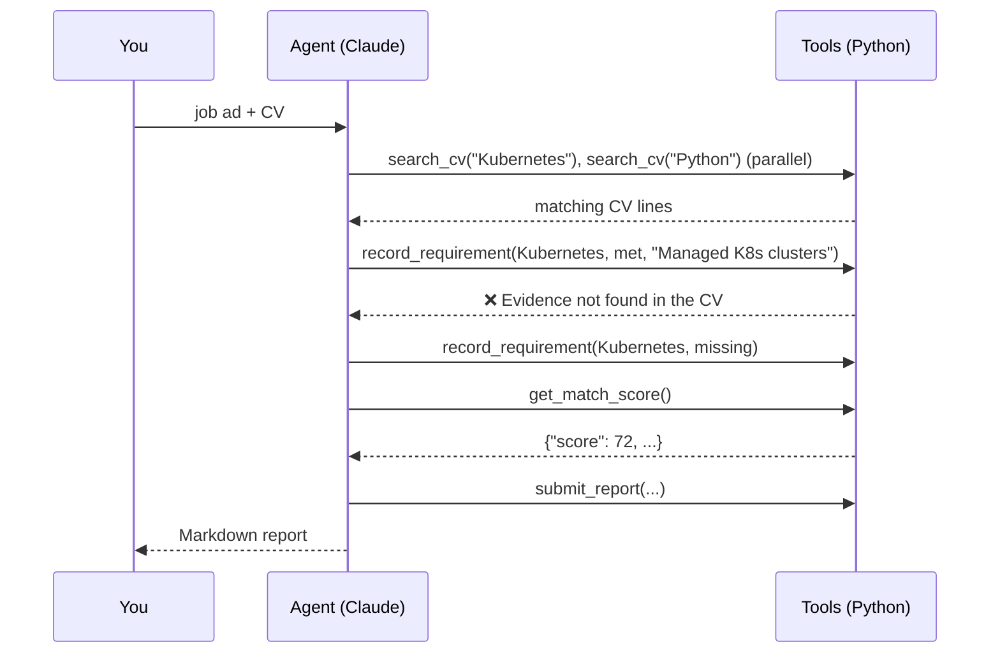

# Job-Match Agent

**An AI agent that compares a CV with a job ad and backs every claim with an exact quote from the CV.**

You give it a job ad and a CV (Markdown, text or PDF). The agent works out the job's
requirements, searches the CV for evidence, rates each requirement as met, partial or missing,
computes a match score, and writes a report with gaps, concrete advice and a tailored
cover-letter outline.


## The core idea: the model judges, the code enforces facts

LLMs are good at reading a job ad and judging whether "built REST APIs with FastAPI" covers
"experience with backend services". They're bad at being reliably honest about what's *not*
there. So the agent works through tools that enforce the facts:

| Tool | What it does | Guardrail |
|---|---|---|
| `search_cv` | Finds CV lines about a skill, with synonyms ("k8s" → Kubernetes, "LLM" → Claude/GPT) | Read-only |
| `record_requirement` | Records one requirement as met / partial / missing, with evidence | **The evidence must be a word-for-word quote from the CV.** Invented evidence is rejected with an error, and the agent has to search again or mark the requirement missing. |
| `get_match_score` | Computes the 0-100 score | **Computed by code** (must-haves weigh 3×, partial counts half), so it's reproducible |
| `submit_report` | Submits summary, strengths, gaps with advice, cover-letter outline | Rejected until at least 3 requirements are recorded |

The agent loop runs on the Anthropic SDK's **tool runner** (`client.beta.messages.tool_runner`).
When a tool raises `ToolError`, the runner sends the message back to Claude as an error result,
which is how the agent corrects itself.



## Quick start

```bash
git clone https://github.com/oliverkraus-source/job-match-agent.git
cd job-match-agent
python -m venv .venv && source .venv/bin/activate     # Windows: .venv\Scripts\activate
pip install -e ".[dev]"
export ANTHROPIC_API_KEY=sk-ant-...                    # Windows: set it in your environment variables

python -m jobmatch examples/jobs/junior_ai_engineer.md examples/cvs/alex_becker.md -o report.md
```

While it runs you see every tool call, including rejected evidence:

```
  🔎 search_cv('Kubernetes') -> 0 line(s)
  📝 REST APIs [must] -> met
  ✗ record_requirement: Evidence not found in the CV: '...'
  📊 score: 72/100
```

Use your own files with `python -m jobmatch job_ad.pdf my_cv.pdf -o report.md`. Add
`--model claude-haiku-5-5` for a much cheaper run, and `--json run.json` to save the full
tool-call trace.

## Evaluation

`eval/cases.json` pairs the fictional example CVs with the example job ads (strong, medium,
weak and poor matches) and labels the clear-cut answers, e.g. "Sam's CV has no Python, so
Python must be *missing*". `python eval/run_eval.py` runs the agent on every case and reports:

- **Label accuracy:** did the agent rate the labelled requirements correctly?
- **Overclaims:** how often did it mark something *met* that the CV doesn't show? This is the
  most harmful error, because it sets the candidate up to fail in an interview.
- **Score in expected range,** plus evidence retries, turns and cost per run.

<!-- RESULTS: paste the table printed by `python eval/run_eval.py` here -->

## Engineering notes

- **Prompt caching.** Every agent turn re-sends the whole conversation (job ad, CV, earlier tool
  calls). Top-level `cache_control` caches that prefix, so repeated input costs a fraction of the
  normal price. The cost estimate printed after each run comes from the token counts the API reports.
- **Strict tool schemas.** Tools are plain typed Python functions (`@beta_tool(strict=True)`). The
  SDK builds the JSON schemas, and strict mode guarantees the inputs match them, including enums
  like `met | partial | missing`.
- **Bounded loop.** At most 30 turns; the run fails with a clear error if the agent stops or loops
  without submitting a report, or if the model declines.
- **Tested without an API key.** `tests/test_agent.py` runs the real tool runner against a scripted
  fake API (`httpx2.MockTransport`). It covers parallel tool calls, rejected evidence and
  self-correction, the turn limit, refusals, and the exact request sent. 20 tests run in CI.

## Limitations

- Matching quality depends on how the CV is written; tables and multi-column PDFs extract poorly.
- The synonym table is small and hand-written. Embedding search would generalise better.
- The evaluation set is small (4 cases, about 27 labels) and its labels were written by the author.
  It catches regressions and overclaiming; it isn't a benchmark.
- The report is advice, not a hiring decision.

## Project structure

```
jobmatch/
  agent.py       tools + system prompt + tool runner, usage and cost tracking
  session.py     tool logic: CV search, evidence check, scoring, report
  skills.py      synonym table and whole-word matching
  documents.py   load .md/.txt/.pdf, split CV into sections and lines
  report.py      Markdown report
  evaluation.py  grading against labels (overclaims, accuracy, score range)
  pricing.py     cost estimate from token usage
eval/            labelled cases + run_eval.py
examples/        fictional CVs and job ads
tests/           20 tests, no network needed
```
